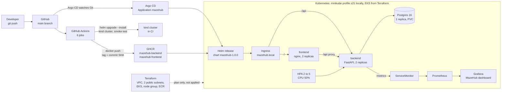

# MazeHub

**Bibek Jyoti Charah — 24bcs10112 — GitHub [SammyUrfen](https://github.com/SammyUrfen)**

MazeHub is a maze gallery. The server generates a maze from a seed with randomized depth-first
carving, proves the maze is solvable with a breadth-first search, and stores the grid. A player
picks a maze, walks it on a canvas with the arrow keys, and the browser records the run when the
player reaches the exit cell. A second mode lets a person draw a maze by hand: the browser toggles
walls on a blank grid, and the server accepts the grid only after five structural checks pass. Two
tables carry the data, `mazes` and `completions`, with a cascading foreign key between them.

Repository: <https://github.com/SammyUrfen/devops-session-21-final-project>

This repository is the Session 21 capstone. The rubric of record is
`devops-heros/session21-python/GRADING.md`, 100 points across 10 modules. Section 15 maps each
module to its evidence and states what is done and what is not.

---

## 2. Architecture



---

## 3. Technologies

| Layer | Technology | Version in use |
|---|---|---|
| Backend | FastAPI, Uvicorn, SQLAlchemy 2, Pydantic Settings | 0.142.2, 0.54.0, 2.1.3, 2.15.0 |
| Migrations | Alembic | 1.20.0 |
| Database | PostgreSQL | 16-alpine |
| Metrics | prometheus-fastapi-instrumentator | 8.1.0 |
| Frontend | React, Vite, canvas, plain CSS | React 19, Vite 7.3.7 |
| Frontend runtime | nginx-unprivileged | 1.29-alpine |
| Backend tests | pytest, SQLite | pytest 9.1.1, Python 3.14.6 locally, 3.12 in CI and in the image |
| Frontend tests | `node --test` | Node 22 |
| Containers | Docker, Docker Compose | compose project `mazehub` |
| CI/CD | GitHub Actions | 6 jobs, `.github/workflows/ci-cd.yml` |
| Registry | GHCR | `ghcr.io/sammyurfen/mazehub-{backend,frontend}` |
| Security | Bandit, pip-audit, npm audit, gitleaks, Trivy | 1.9.4, latest, npm 10, 8.28.0, 0.75.0 |
| Kubernetes | minikube profile `s21`, kind in CI | Kubernetes v1.35.1 locally |
| Packaging | Helm | chart `mazehub-1.0.0` |
| Monitoring | kube-prometheus-stack, Grafana | chart 92.1.0, Grafana 13.2.3 |
| GitOps | Argo CD | `gitops/application.yaml` |
| Infrastructure | Terraform, AWS VPC and EKS modules | Terraform 1.16.1, AWS provider 5.100.0, VPC `~> 5.8`, EKS `~> 20.37` |

---

## 4. The application

### The maze generator

| Item | Detail |
|---|---|
| Algorithm | Randomized depth-first carving on a grid of cells |
| Randomness | One seed for each maze, stored on the row, so the grid is reproducible |
| Cell encoding | One integer for each cell, a 4-bit wall bitmask. N=1, E=2, S=4, W=8. A closed cell is 15 |
| Shared walls | The two cells beside a wall always agree, so the renderer draws every edge cleanly |
| Entrance and exit | `(0, 0)` and `(width - 1, height - 1)` |
| Sizes | EASY 8x8, MEDIUM 14x14, HARD 20x20. The map is `SIZES` in `backend/app/maze.py` |
| Storage | The grid is JSON text in `mazes.grid` |

### The solver

| Item | Detail |
|---|---|
| Algorithm | Breadth-first search from the entrance to the exit |
| Output | `solution_length`, the count of cells on the shortest path, entrance and exit included |
| Move count | The smallest possible move count is `solution_length - 1` |
| Use | It fills `solution_length`, it answers `GET /api/mazes/{id}/solution`, and it is the invariant guard |

### The invariant guard

The generator calls the solver before it returns a grid. A grid with no path from the entrance to
the exit is rejected and never reaches the database. Every stored maze is therefore solvable. The
same search also feeds the cheat guard: `POST /api/mazes/{id}/completions` returns 422 when `moves`
is below `solution_length - 1`, and the message names both numbers.

### The structural guard on drawn grids

A hand-drawn grid arrives from the browser. The server trusts none of it. Each check returns its own
422 message. Real messages from the verification run are in `.evidence/community-verify.txt`.

| # | Check | Example message |
|---|---|---|
| 1 | `width` and `height` are 4 to 20, and the grid matches them | `size 2x2 is out of range, width and height must be between 4 and 20` |
| 2 | Every value is an integer from 0 to 15 | `cell (4, 4) is 99, every value must be an integer between 0 and 15` |
| 3 | The outer border is closed on all four sides | `the border is open at the top of column 0, an outer wall cannot be removed` |
| 4 | Neighbours agree about the wall between them | `cells (0, 0) and (1, 0) disagree about the wall between them` |
| 5 | A path exists from the entrance to the exit | `no path leads from the entrance to the exit, the maze cannot be finished` |

Check 4 is the one a drawing tool breaks most often. The browser toggles both sides of a shared
wall, and the server repeats the check anyway. A drawn maze has no seed. Its difficulty is a derived
badge: under 20 is EASY, 20 to 44 is MEDIUM, 45 and above is HARD. A `difficulty` value on
`PUT` of a drawn maze returns 422, because the server must not replace a grid a person drew.

Drawn mazes carry `source=COMMUNITY` and sit in their own gallery tab, so they never appear beside a
generated maze.

### Endpoints

| Method | Path | Body | Returns |
|---|---|---|---|
| GET | `/` | — | Service name, environment, docs path |
| GET | `/health` | — | `{"status": "UP"}`. No database read |
| GET | `/ready` | — | `{"status": "READY"}`. Reads the database |
| GET | `/metrics` | — | Prometheus text format |
| GET | `/api/config` | — | `{environment, banner}` |
| GET | `/api/mazes` | — | List, newest first. Query: `difficulty`, `author`, `source` |
| GET | `/api/mazes/stats` | — | `{total, by_difficulty, by_source, completions, authors}` |
| GET | `/api/mazes/{id}` | — | One maze with its grid. 404 when missing |
| POST | `/api/mazes` | `{title, author?, difficulty}` | 201. The server picks the seed and generates the grid |
| POST | `/api/mazes/community` | `{title, author?, width, height, grid}` | 201 with `source=COMMUNITY`, after the five checks |
| PUT | `/api/mazes/{id}` | `{title?, difficulty?}` | A difficulty change regenerates the grid. 404 when missing |
| DELETE | `/api/mazes/{id}` | — | 204. The completions cascade away |
| GET | `/api/mazes/{id}/solution` | — | `{path: [[x, y], ...], length}` |
| POST | `/api/mazes/{id}/completions` | `{player, moves, seconds}` | 201. 422 when `moves` is impossible |
| GET | `/api/completions` | — | List, newest first. Query: `player` |

`/api/mazes/stats` is declared before `/api/mazes/{id}`, because FastAPI matches paths in
declaration order.

The frontend never sends `seed`, `width`, `height`, `grid` or `solution_length` for a generated
maze. The full contract is in `PLAN.md` sections 10 and 11.

---

## 5. Local run

```bash
docker compose up --build
```

Three services start, as `docker-compose.yml` defines them.

| Service | Image | Host port | Container port |
|---|---|---|---|
| `frontend` | built from `frontend/Dockerfile` | 3000 (`FRONTEND_PORT` overrides it) | 8080 |
| `backend` | built from `backend/Dockerfile` | 8000 | 8000 |
| `postgres` | `postgres:16-alpine` | none | 5432, inside the compose network |

Open <http://localhost:3000>. The frontend proxies `/api` to the backend through nginx, so the
browser needs no CORS rule.

The backend waits for the Postgres health check, then runs the Alembic migration before it serves.
The container command is `alembic upgrade head && exec uvicorn app.main:app`. From
`.evidence/compose-verify.txt`:

```text
backend-1  | INFO  [alembic.runtime.migration] Running upgrade  -> 0001_create_mazes, Create the mazes and completions tables.
backend-1  | INFO:     Uvicorn running on http://0.0.0.0:8000
```

`alembic current` then reports `0002_add_maze_source (head)`, and `\dt` lists `alembic_version`,
`completions` and `mazes`.

One note on the port. During the capture session another project held port 3000, so the stack ran
on 3001. The compose default is still 3000. `.evidence/CAPTURE.md` records that.

---

## 6. Tests

| Suite | Count | Command |
|---|---|---|
| Backend, pytest | 39 | `cd backend && python -m pytest -v` |
| Frontend, node test runner | 10 | `cd frontend && node --test src/maze.test.mjs` |

Both numbers come from `.evidence/community-verify.txt`, sections 1 and 3. The pipeline runs both in
job 1, so a failure stops the build before any image exists.

What the backend tests cover, across four files:

| File | Covers |
|---|---|
| `tests/test_maze.py` | Every cell is reachable, the same seed gives the same grid, the solver length matches the path, the sizes match the contract |
| `tests/test_api.py` | Health, readiness, metrics, config, create, bad difficulty, read and 404, list order and filters, a difficulty change resizing the grid, delete then 404, stats, the solution endpoint, the completion flow, the cheat guard, a completion on a missing maze |
| `tests/test_drawn.py` | The five structural checks and the derived difficulty label |
| `tests/test_community_api.py` | The community publish route, the source filter, `by_source` in stats, and the refused difficulty `PUT` |

The frontend tests cover the wall-bit move rules, the stat-tile flattening, and the drawing rules: a
fresh grid is fully closed, a toggle changes both sides, a double toggle returns the start state, a
border wall cannot be toggled, and the local search agrees with a known small grid.

**The test database.** `backend/tests/conftest.py` sets `DATABASE_URL=sqlite:///./test.db` before
`app.config` is imported, and the `client` fixture drops and recreates every table for each test.
Postgres is never touched by a test. `backend/pytest.ini` sets `pythonpath = .` and
`testpaths = tests`.

`ruff check app/ tests/` passes with no finding.

---

## 7. Docker

| Image | Base | User | Port |
|---|---|---|---|
| Backend | `python:3.12-alpine` | uid 10001, `appuser`, created with `adduser -D -H` | 8000 |
| Frontend | `nginxinc/nginx-unprivileged:1.29-alpine` | uid 101, from the base image | 8080 |

The frontend build is multi-stage. Stage one is `node:22-alpine`: it runs `npm ci` and
`npm run build`. Stage two is nginx-unprivileged, and it copies only `dist/` plus the nginx
template. No Node toolchain and no `node_modules` directory reaches the runtime image.

Both bases are Alpine on purpose. Alpine ships far fewer OS packages than a Debian slim image, so
far fewer CVEs arrive with the base. The backend image also uninstalls pip after the dependency
install, because the app never runs pip and its vendored libraries carried fixable HIGH CVEs. The
frontend image runs one `apk upgrade` as root, then drops back to uid 101: the 1.29 base shipped
Alpine 3.23 packages with fixable HIGH CVEs, and the upgrade pulls the fixed versions. Section 9
and `security/TRIVY.md` carry the scan numbers.

Both Helm Deployments also set `allowPrivilegeEscalation: false` and `runAsNonRoot: true`.

---

## 8. CI/CD

The workflow is `.github/workflows/ci-cd.yml`. It triggers on a push to `main`, on a pull request to
`main`, and on manual dispatch. It ignores changes limited to `gitops/**` and `**.md`, because a
values-only GitOps change needs no new image.

| # | Job | Does |
|---|---|---|
| 1 | Build + unit test | `pytest -v`, `node --test`, `npm run build`, `helm lint helm/mazehub` |
| 2 | SAST (Bandit) | A full report that never fails, then a gate that fails on MEDIUM or higher |
| 3 | SCA | `pip-audit` on the backend requirements, `npm audit --audit-level=high` on the frontend |
| 4 | Secret scan | gitleaks over the whole history, `fetch-depth: 0` |
| 5 | Docker build, scan, gate, push | Builds both images, scans both with Trivy, gates, then pushes |
| 6 | Deploy with Helm to kind | Creates a kind cluster, installs the chart, runs a smoke test |

Jobs 1 to 4 run in parallel. Job 5 declares `needs: [test, sast, sca, secrets]`, so nothing is built
and nothing is pushed unless all four pass. Job 6 needs job 5.

**Image tags.** Both images are tagged with `${{ github.sha }}`, never `latest`:

```bash
docker build -f backend/Dockerfile  -t ghcr.io/sammyurfen/mazehub-backend:$GITHUB_SHA  backend
docker build -f frontend/Dockerfile -t ghcr.io/sammyurfen/mazehub-frontend:$GITHUB_SHA frontend
```

**GHCR.** The push step runs only on `main`. It logs in with the built-in `GITHUB_TOKEN` and the
job-scoped `packages: write` permission, so the repository holds no registry secret. The packages are
private, which matters for the local cluster: see section 10.

**The kind deploy.** Job 6 creates a kind cluster named `s21` with `helm/kind-action`, makes a
`docker-registry` pull secret for GHCR, then runs `helm upgrade --install` with the two SHA tags and
with `monitoring.enabled=false`, `ingress.enabled=false` and `hpa.enabled=false`. The CI cluster has
no kube-prometheus-stack CRDs and no ingress controller, so those three templates stay off. A smoke
pod then curls `mazehub-backend:8000/ready` and `mazehub-frontend/api/mazes/stats` from inside the
cluster. A failure prints `describe pods` and the event list.

The last run of the whole pipeline on `main`, commit `7d8bcd1`, was green in all six jobs. The run
for the newest commit, `3db8615`, was still in progress when this file was written.

---

## 9. DevSecOps

Five scanners run on every push. The detail of the Trivy result is in
**[`security/TRIVY.md`](security/TRIVY.md)**.

| Scanner | Looks at | Gate |
|---|---|---|
| Bandit 1.9.4 | The backend Python source, `backend/app` | Fails on MEDIUM or higher. A full report runs first with `--exit-zero` |
| pip-audit | `backend/requirements-dev.txt` | Fails on any known vulnerability |
| npm audit | `frontend/package-lock.json` | Fails on high or critical |
| gitleaks 8.28.0 | The whole Git history, with `security/gitleaks.toml` | Fails on any match. Every default rule is on, nothing is allow-listed |
| Trivy 0.75.0 | Both built images: the OS package database and the Python packages inside them | Fails on a **fixable** HIGH or CRITICAL. `--ignore-unfixed`, `--ignorefile security/.trivyignore` |

**The gate rule.** Every scanner runs in a job that job 5 declares in `needs`, or inside job 5
before the push step. So the ordering is strict: the code is tested, then scanned, then built, then
the image is scanned, and only then is anything pushed to GHCR or deployed. A red scanner leaves the
registry untouched.

Both ignore files are empty on purpose. `security/.trivyignore` holds only a comment that says every
fixable HIGH or CRITICAL must be fixed rather than hidden, and `security/gitleaks.toml` extends the
default rule set and allow-lists nothing.

---

## 10. Kubernetes and Helm

The local cluster is the minikube profile `s21`: Kubernetes v1.35.1, the docker driver, 4 CPUs and
3072 MB. Full output is in `.evidence/k8s-verify.txt`.

| Item | Value |
|---|---|
| Namespace | `mazehub`, from `k8s/namespace.yaml`, labelled `app.kubernetes.io/part-of=mazehub` |
| Chart | `helm/mazehub`, `mazehub-1.0.0`, app version 1.0.0 |
| Templates | `backend.yaml`, `frontend.yaml`, `postgres.yaml`, `config.yaml`, `ingress.yaml`, `hpa.yaml`, `monitoring.yaml`, `_helpers.tpl` |
| Values | `helm/mazehub/values.yaml` is the default. `k8s/values-local.yaml` overrides the images for minikube. `gitops/values-minikube.yaml` is the Argo CD layer |
| Replicas | backend 2, frontend 2, postgres 1 |
| Services | `mazehub-backend` ClusterIP 8000, `mazehub-frontend` ClusterIP 80 to container 8080, `mazehub-postgres` ClusterIP 5432 |
| Ingress | class `nginx`, host `mazehub.local`, address 192.168.58.2 |
| Ingress paths | `/api` to `mazehub-backend:8000`, `/` to `mazehub-frontend:80` |
| HPA | `mazehub-backend`, min 2, max 5, CPU target 50%. Observed `cpu: 13%/50%` at 2 replicas |
| Backend probes | readiness `GET /ready` every 5 s after 5 s. Liveness `GET /health` every 10 s after 15 s |
| Frontend probes | readiness and liveness both `GET /healthz`, every 5 s and every 10 s |
| Resources | Every container sets requests and limits. The backend asks 100m CPU and 96Mi, and caps at 500m and 256Mi |

The chart renders the ConfigMap checksum into the Deployment, so a values-only change rolls the pods.

**Images in the local run.** The GHCR packages are private, so the two images are built straight into
the cluster's own docker daemon as `mazehub-backend:dev` and `mazehub-frontend:dev`.
`k8s/values-local.yaml` carries those tags and `imagePullPolicy: Never`. CI instead pulls the GHCR
images by commit SHA with a pull secret.

### The exact commands

```bash
export KUBECONFIG=$HOME/.kube/s21.yaml

kubectl apply -f k8s/namespace.yaml
helm lint helm/mazehub -f k8s/values-local.yaml

helm upgrade --install mazehub helm/mazehub -f k8s/values-local.yaml \
  -n mazehub --create-namespace --wait --timeout 8m

helm list -n mazehub
kubectl get deploy,svc,pods,hpa -n mazehub
kubectl describe ingress mazehub -n mazehub

# minikube ip is 192.168.58.2. The Host header stands in for a DNS entry.
curl -H 'Host: mazehub.local' http://192.168.58.2/
curl -H 'Host: mazehub.local' http://192.168.58.2/api/mazes/stats
```

For a browser, add the name once: `echo '192.168.58.2 mazehub.local' | sudo tee -a /etc/hosts`, then
open <http://mazehub.local/>.

A maze published through the Ingress reached Postgres in the verification run, and
`psql -c 'select id, title, difficulty from mazes'` showed the row. That is the whole path, browser
to Ingress to Service to pod to database.

---

## 11. Monitoring

| Item | Value |
|---|---|
| `/metrics` | On the backend, `text/plain; version=1.0.0`, from prometheus-fastapi-instrumentator |
| Metric families | `http_requests_total` by handler, method and status class, `http_request_duration_seconds` histogram, request and response size summaries, plus the Python process metrics |
| Prometheus | kube-prometheus-stack 92.1.0, release `kps`, namespace `monitoring`. Values in `monitoring/kps-values.yaml` |
| ServiceMonitor | `mazehub-backend` in the `mazehub` namespace, from the chart's `monitoring.yaml` |
| PrometheusRule | `mazehub-alerts`, same template |
| Targets | Job `mazehub-backend`, both pod endpoints `up`: `10.244.0.103:8000/metrics` and `10.244.0.107:8000/metrics` |
| Grafana | 13.2.3, release `kps-grafana`. Datasource `prometheus`, pinned by uid. Dashboard uid `mazehub`, from `monitoring/grafana-dashboard.yaml` |

The five dashboard panels, with the query each one runs:

| Panel | Query |
|---|---|
| Requests per second by handler | `sum by (handler) (rate(http_requests_total{job="mazehub-backend"}[1m]))` |
| p95 latency | `histogram_quantile(0.95, sum by (le) (rate(http_request_duration_seconds_bucket{job="mazehub-backend"}[5m])))` |
| Responses per second by status class | `sum by (status) (rate(http_requests_total{job="mazehub-backend"}[1m]))` |
| Backend targets up | `sum(up{job="mazehub-backend"})` |
| Requests served (total) | `sum(http_requests_total{job="mazehub-backend"})` |

Every panel held a value when Prometheus answered the same queries directly: p95 was 0.095 s, 2xx
was 3.84 requests each second against 0.45 for 4xx, and the total was 751 requests. A traffic loop
runs during the capture window, so the rate panels hold a live line rather than a flat zero.

### Port-forward URLs

```bash
kubectl -n monitoring port-forward svc/kps-kube-prometheus-stack-prometheus 42110:9090
kubectl -n monitoring port-forward svc/kps-grafana 42120:80
```

| Page | URL |
|---|---|
| Prometheus targets | <http://127.0.0.1:42110/targets?search=mazehub> |
| Prometheus alert rules | <http://127.0.0.1:42110/alerts> |
| Grafana dashboard | <http://127.0.0.1:42120/d/mazehub/mazehub> |

Grafana signs in with `admin` and the demo password set in `monitoring/kps-values.yaml`. It is a
demo value in a local cluster, not a secret.

---

## 12. GitOps

`gitops/application.yaml` declares an Argo CD `Application` named `mazehub`. It points at this
repository on `main`, renders `helm/mazehub` with `gitops/values-minikube.yaml`, and targets the
`mazehub` namespace. `syncPolicy.automated` has `prune: true` and `selfHeal: true`, so Argo CD
deletes what Git no longer declares and reverts a manual change. Editing
`gitops/values-minikube.yaml` and pushing is the whole deploy step. The CI workflow ignores
`gitops/**` for that reason: a values-only change needs no new image.

**Honest state.** Argo CD is installed in this cluster but **scaled to zero**, to free memory for
the MazeHub release and kube-prometheus-stack on a 3072 MB node:

```text
deployment.apps/argocd-applicationset-controller   0/0
deployment.apps/argocd-redis                       0/0
deployment.apps/argocd-repo-server                 0/0
statefulset.apps/argocd-application-controller     0/0
```

The loop was proven end to end on 7 October, under the earlier application name `incidentboard`:
a banner change was committed and pushed, Argo CD synced the new revision, the ConfigMap checksum
changed, a new ReplicaSet rolled, and the new banner answered through the Ingress. That output is in
`.evidence/argo2.txt`. The `Application` object still in the cluster carries the old name. The
renamed manifest has **not** been applied again since the rename to MazeHub. Scaling the four
workloads back up re-runs the loop.

---

## 13. Terraform

`terraform/` builds the AWS infrastructure. `terraform/README.md` is the long version.

| Piece | Detail |
|---|---|
| VPC | `terraform-aws-modules/vpc/aws`, pinned `~> 5.8`. CIDR `10.21.0.0/16`, region `ap-south-1` |
| Public subnets | Two, `10.21.101.0/24` in `ap-south-1a` and `10.21.102.0/24` in `ap-south-1b`, tagged `kubernetes.io/role/elb = 1` |
| Private subnets | Two, `10.21.1.0/24` and `10.21.2.0/24`, tagged `kubernetes.io/role/internal-elb = 1`. The worker nodes sit here, so no node has a public IP |
| Egress | One NAT gateway in a public subnet. One, not two, as a deliberate cost trade-off |
| EKS | `terraform-aws-modules/eks/aws`, pinned `~> 20.37`. Cluster `mazehub-eks`, Kubernetes 1.31 |
| Node group | One managed group named `main`. `t3.medium`, desired 2, min 2, max 3 |
| ECR | Two repositories, `mazehub-backend` and `mazehub-frontend`, each keeping 10 images |
| Plan | `Plan: 62 to add, 0 to change, 0 to destroy.` No error and no warning, 1616 lines |
| Cost | About **USD 0.27 each hour**: control plane 0.10, two nodes 0.1056, NAT 0.056, Elastic IP 0.005, two root volumes about 0.002. A 75 minute window costs about USD 0.35 |

Evidence: `.evidence/terraform-checks.txt` and `.evidence/terraform-plan.txt`.

| Command | State |
|---|---|
| `terraform version` (1.16.1) | Ran |
| `terraform init` | Ran. Clean |
| `terraform fmt -recursive` | Ran. No file needed a change |
| `terraform validate` | Ran. `Success! The configuration is valid.` |
| `terraform plan` | Ran. 62 to add |
| `terraform apply` | **Pending. The user runs it in the screenshot window** |
| `terraform destroy` | **Pending. The user runs it in the screenshot window** |

**No AWS resource exists today.** Nothing in this repository has created a VPC, a cluster, a node or
a repository in AWS. Only the plan ran.

The IAM user needs rights first. EKS creation calls `iam:CreateRole`, `iam:AttachRolePolicy`,
`iam:PassRole`, `eks:*` and `logs:*`. Attach `AdministratorAccess` to `SammyUrfen-CLI` for the
window, then remove it.

```bash
aws sts get-caller-identity          # 0. confirm the identity
cd terraform
terraform init                       # 1. providers and the two registry modules
terraform fmt -recursive             # 2. offline checks, free
terraform validate
terraform plan                       # 3. read it: 62 to add
terraform apply                      # 4. about 15 minutes. THIS COSTS MONEY
aws eks update-kubeconfig --region ap-south-1 --name mazehub-eks   # 5.
kubectl get nodes                    # 6. the two nodes join and turn Ready
                                     # 7. screenshots: the VPC page, the EKS cluster page
terraform destroy                    # 8. about 15 minutes. Do not skip this
```

`terraform.tfvars`, `.terraform/` and every `*.tfstate` file are git-ignored.
`terraform.tfvars.example` is committed and holds no real credential. `.terraform.lock.hcl` is
committed on purpose, so a later `init` resolves the same provider versions. State is local, which
suits one operator on one laptop and would not suit a team.

> Run `terraform destroy` as soon as the screenshots are done. A cluster left overnight costs about
> USD 6.50, and a month costs about USD 195.

---

## 14. Troubleshooting

`k8s/troubleshooting/` holds **five** break cases. Each one is applied to the running Helm release
and then undone. Case 3 is the one with captured output, in `.evidence/k8s-verify.txt`. The other
four carry the break file and the fix, and have not been captured in this session.

### Case 1 — Bad image tag

| | |
|---|---|
| Symptom | The new pod never becomes Ready. `kubectl get pods` shows `ImagePullBackOff` |
| Investigation | `kubectl describe pod` and read the events at the bottom |
| Root cause | `helm upgrade --set backend.tag=does-not-exist` asks for a tag that no registry holds |
| Fix | `helm rollback mazehub`, or upgrade again with a tag that exists |
| Verification | `kubectl get pods -n mazehub` shows `1/1 Running`, and the old ReplicaSet scales to zero |
| State | Not captured this session |

### Case 2 — Wrong Service selector

| | |
|---|---|
| Symptom | A curl through the Ingress returns 503. The pods are all Running |
| Investigation | `kubectl get endpoints mazehub-backend -n mazehub` lists no address. Compare the Service selector with the pod labels |
| Root cause | `k8s/troubleshooting/2-wrong-selector.yaml` sets the selector to `app: backend-v2`, a label no pod carries, so the Service matches nothing |
| Fix | Patch the selector back to `app: backend`, then `helm upgrade` |
| Verification | `kubectl get endpoints` lists both pod IPs on port 8000, and the curl returns 200 |
| State | Not captured this session |

### Case 3 — Failing readiness probe

| | |
|---|---|
| Symptom | A pod sits at `0/1 Running` and never joins the Service |
| Investigation | `kubectl get events -n mazehub --field-selector reason=Unhealthy` printed `Readiness probe failed: HTTP probe failed with statuscode: 404`. `kubectl get endpoints mazehub-backend` listed only the two healthy pod IPs |
| Root cause | `3-failing-probe.yaml` points the readiness probe at `/readyz`, a path the app does not serve. The container is alive, so the kubelet does not restart it. It is simply never Ready |
| Fix | A plain `helm upgrade` is **refused**: `conflict with "kubectl-patch"`. `kubectl patch` became the field owner under server-side apply. Give the field back with the same tool, then upgrade: `kubectl patch deploy mazehub-backend -n mazehub --type=json -p '[{"op":"replace","path":"/spec/template/spec/containers/0/readinessProbe/httpGet/path","value":"/ready"}]'` and then `helm upgrade mazehub helm/mazehub -f k8s/values-local.yaml -n mazehub --wait`. `helm upgrade --force` also works, because it replaces the object and drops every field manager, but it recreates the Deployment instead of rolling it |
| Verification | Revision 4 deployed, all five pods back at `1/1 Running`, and the two endpoint addresses unchanged |
| State | **Captured.** `.evidence/k8s-verify.txt`, the section "the readiness probe really gates traffic" |

This case also proves the probe does its job: the unready pod stayed out of the Service endpoint
list for its whole life, so no request ever reached it.

### Case 4 — Missing Secret key

| | |
|---|---|
| Symptom | The backend pod crashes at start and enters `CrashLoopBackOff` |
| Investigation | `kubectl logs` shows the container failing before Uvicorn binds. `kubectl describe pod` names the missing key |
| Root cause | Removing `DATABASE_URL` from the `mazehub-db` Secret leaves the `envFrom` reference unresolvable, so the container cannot build a database URL |
| Fix | `helm upgrade` rewrites the Secret from the chart |
| Verification | `kubectl get pods` shows `1/1 Running`, and `curl /ready` returns `{"status": "READY"}` |
| State | Not captured this session |

### Case 5 — Bad Ingress backend port

| | |
|---|---|
| Symptom | `/` loads but `/api` returns 502 or 503 from nginx |
| Investigation | `kubectl describe ingress mazehub -n mazehub` shows the `/api` rule pointing at port 8080. `kubectl get svc` shows the backend Service on 8000 |
| Root cause | `5-bad-ingress-backend.yaml` replaces the backend port with 8080. The Service has no such port, so the controller has nowhere to send the request |
| Fix | Patch the port back to 8000, then `helm upgrade`. The same field-ownership conflict as case 3 applies |
| Verification | `curl -H 'Host: mazehub.local' http://192.168.58.2/api/mazes/stats` returns the JSON counts |
| State | Not captured this session |

---

## 15. Rubric map

| Module | Points | Evidence | State |
|---|---|---|---|
| M1 Application | 10 | `backend/app/`, `backend/alembic/versions/0001_create_mazes.py` and `0002_add_maze_source.py`, `frontend/src/`, `docker-compose.yml`, `.evidence/compose-verify.txt`, `.evidence/ui-0*.png` and `ui-10-*.png` | Done. 14 endpoints, two tables with a cascade, two Alembic migrations, a React canvas UI |
| M2 Testing | 10 | `backend/tests/` (4 files), `backend/pytest.ini`, `backend/tests/conftest.py`, `.evidence/community-verify.txt` sections 1 to 3 | Done. 39 pytest plus 10 node tests, on a throwaway SQLite file, never Postgres |
| M3 Git and GitHub | 5 | `git log`, `.gitignore` | Done. Public repository, 17 commits, each message a sentence. `.gitignore` excludes `.env`, `__pycache__`, `node_modules` and `.venv` |
| M4 Docker | 10 | `backend/Dockerfile`, `frontend/Dockerfile`, `docker-compose.yml`, `.evidence/compose-verify.txt` | Done. A multi-stage frontend build, non-root in both images, three services up |
| M5 CI/CD | 15 | `.github/workflows/ci-cd.yml`, Actions run for `7d8bcd1` | Done. Six jobs green, both images tagged with the commit SHA, pushed to GHCR, deployed to kind with a smoke test. GHCR packages are private, so the package page needs the owner's own session for a screenshot |
| M6 Trivy | 5 | `security/TRIVY.md`, `security/.trivyignore`, job 5 of the workflow | Done. Both images scanned. The gate fails on a fixable HIGH or CRITICAL. The last scan found one MEDIUM, `CVE-2026-85091` in zlib |
| M7 Terraform | 15 | `terraform/`, `terraform/README.md`, `.evidence/terraform-checks.txt`, `.evidence/terraform-plan.txt` | **Partly.** The code, `init`, `fmt`, `validate` and a 62-resource plan are done. `apply` and `destroy` are pending, and the AWS console screenshots depend on them. No AWS resource exists |
| M8 Kubernetes and Helm | 15 | `k8s/`, `helm/mazehub/`, `.evidence/k8s-verify.txt`, `.evidence/ui-20-app-through-ingress.png` | Done on minikube `s21`. Namespace, chart, install, 2 plus 2 replicas, three ClusterIP Services, the two Ingress paths, every pod Running, HPA and probes. Not yet run on EKS |
| M9 Observability | 10 | `monitoring/`, `.evidence/k8s-verify.txt` sections M9.1 to M9.4, `.evidence/ui-20-prometheus-targets.png`, `ui-20-grafana-dashboard.png` | Done. `/metrics` in Prometheus format, both pod targets `up`, Grafana reachable, five populated panels |
| M10 Documentation and demo | 5 | This `README.md`, `scripts/demo-runsheet.md` | README done. The live demo is for the presentation session, and the runsheet is the script for it |

Two layout notes. The homework file asks for `application/`, `docker/` and `kubernetes/`, and the
rubric asks for `backend/`, `frontend/`, `docker-compose.yml` at the root and `k8s/`. The rubric
carries the points, so this repository follows the rubric. `.evidence/` is git-ignored: it holds raw
command output and screenshots for the submission, not source.

---

## 16. Lessons learned

- A `kubectl patch` takes ownership of the field it touches. After that, `helm upgrade` stops with a
  conflict instead of winning. Server-side apply is per-field, and the fix is to hand the field back
  with the same tool.
- A readiness probe that fails does not restart anything. The container stays alive and simply never
  joins the Service. That is the point, and the endpoint list is where you see it.
- Alpine over Debian slim cut the image findings to one MEDIUM. Removing pip after the install and
  running one `apk upgrade` in the frontend stage closed the rest. Choosing the base is cheaper than
  triaging CVEs later.
- The security gate has to be an edge in the job graph, not a step ordering. `needs: [test, sast,
  sca, secrets]` on the build job is what makes a red scanner mean "nothing is pushed".
- Declaration order decides FastAPI routing. `/api/mazes/stats` must come before
  `/api/mazes/{id}`, or `stats` is read as an id.
- A client-side check is for speed, never for trust. The browser runs the same breadth-first search
  so the Check button is instant, and the server runs all five structural checks again anyway.
- Memory, not CPU, was the limit on a 3072 MB node. Argo CD and kube-prometheus-stack together left
  no room for the app, and scaling Argo CD to zero was the honest trade rather than pretending both
  fit.
- Writing down the frozen API contract before the frontend existed meant the two halves met without
  a rename. The cost was 30 minutes. The saving was larger.
